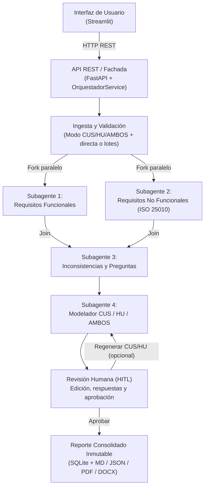

# MultiAgenteAnalisisRequisitos

Sistema multiagente de apoyo a la ingeniería de requisitos que transforma descripciones textuales o documentos (`.txt`, `.md`, `.pdf`) en especificaciones estructuradas de **Requisitos Funcionales (RF)**, **Requisitos No Funcionales (ISO/IEC 25010)**, **Inconsistencias con preguntas de clarificación** y **Casos de Uso (CUS), Historias de Usuario (HU) o ambos (`AMBOS`)** según la modalidad elegida antes del envío (fija por corrida), con revisión y aprobación humana (*Human-in-the-Loop*).

---

## Flujo y Arquitectura (Streamlit + FastAPI + LangGraph)



---

## Estructura Principal

- `src/schemas/`: Contratos Pydantic v2 y `GraphState` compartido (`SDD`).
- `src/services/`: Ingesta dual (`ingesta.py`), seguridad (`seguridad.py`), adaptadores LLM con fallback (`llm_client.py`), exportación (`exportador.py`), fachada (`orchestrator.py`) y cliente HTTP (`api_client.py`).
- `src/agents/`: Nodos especializados (`RF`, `RNF`, `Inconsistencias`, `Modelador CUS/HU`).
- `src/graph/`: Orquestación `StateGraph` con *checkpoints* e interrupción HITL (`workflow.py`).
- `src/persistence/`: Modelos ORM y repositorio SQLite con versionado e inmutabilidad (`models.py`, `repository.py`).
- `src/api/`: Endpoints REST en FastAPI (`app.py`, `schemas.py`) y servidor de demostración (`demo.py`).
- `src/ui/`: Interfaz visual en Streamlit (`app.py`).
- `specs/`: Constitución del proyecto y especificaciones Spec Kit (`spec.md`, `plan.md`, `tasks.md`).
- `tests/unit/`: Suite TDD ejecutada con mocks locales (sin llamadas reales a APIs).

---

## Pruebas Locales

```bash
pip install -e ".[dev]"
pytest -v
```
