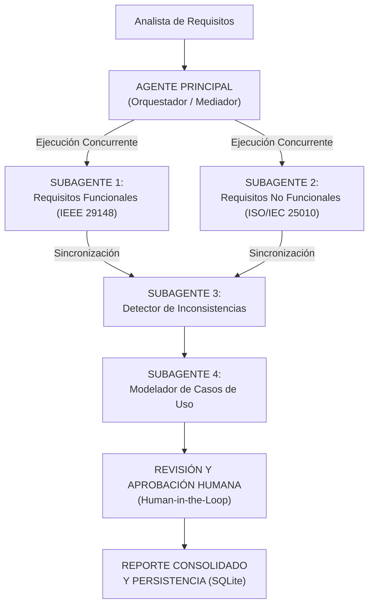

# Documento Maestro de Propuesta de Proyecto
## Sistema Multiagente de Análisis de Requisitos de Software

**Curso:** Arquitectura y Evolución de Software (2026-2)  
**Grupo:** Grupo 6  
**Integrantes:**
* `202311375` - Castillo Jorge, Fabrizio Leonardo
* `202211070` - Correa Giron, Joshue Sebastian
* `202420891` - Mamani Leon, Sebastian Leonel
* `200310095` - Martell Castillo, Francisco Jose

---

## 1. INTRODUCCIÓN
El análisis de requisitos es una de las etapas más importantes dentro del desarrollo de software, ya que permite identificar las necesidades de los usuarios y establecer las funcionalidades y restricciones que deberá cumplir un sistema.

Sin embargo, este proceso presenta dificultades cuando la información proporcionada por los interesados es extensa, ambigua, incompleta o contradictoria. Los errores cometidos en esta fase inicial se propagan a lo largo de todo el ciclo de vida del proyecto, elevando significativamente los costos y tiempos de corrección en etapas de diseño, codificación y pruebas.

Por este motivo, nuestro proyecto propone desarrollar un sistema de software basado en una arquitectura multiagente de inteligencia artificial que permita automatizar y asistir en el análisis de requisitos. El sistema contará con un agente principal encargado de coordinar las actividades y cuatro subagentes especializados en identificar requisitos funcionales, requisitos no funcionales bajo normas internacionales, inconsistencias semánticas y casos de uso detallados.

La finalidad es proporcionar una herramienta de apoyo para estudiantes, analistas de sistemas y equipos de desarrollo de software, facilitando la elaboración de especificaciones de requisitos organizadas, coherentes y verificables.

---

## 2. PROBLEMÁTICA
Actualmente, el análisis de requisitos suele realizarse de forma predominantemente manual mediante reuniones, entrevistas, minutas y documentos redactados en lenguaje natural por los clientes.

Durante este proceso se presentan los siguientes problemas recurrentes:
* Dificultad para identificar y redactar correctamente los requisitos funcionales de manera atómica.
* Confusión habitual entre requisitos funcionales y restricciones de calidad o requisitos no funcionales.
* Presencia de términos vagos, subjetivos o ambiguos que no pueden medirse ni comprobarse formalmente.
* Contradicciones lógicas entre las necesidades expresadas por distintas áreas o usuarios.
* Omisión de flujos alternativos, precondiciones y manejo de excepciones en los casos de uso.
* Demoras considerables en la redacción y revisión de documentos de especificación.
* Falta de trazabilidad directa entre la solicitud original del usuario y los requisitos finalmente definidos.

Estos problemas afectan el diseño arquitectónico posterior y conducen a reprocesos costosos. Por ello, se requiere una solución de software que distribuya el análisis entre agentes de inteligencia artificial especializados gobernados por un mecanismo riguroso de orquestación, persistencia y validación humana.

---

## 3. OBJETIVOS

### 3.1. Objetivo General
Diseñar e implementar un sistema de software basado en una arquitectura multiagente de inteligencia artificial que permita analizar descripciones textuales o solicitudes de software, identificar requisitos funcionales y no funcionales, detectar inconsistencias y modelar casos de uso mediante la colaboración coordinada de agentes especializados.

### 3.2. Objetivos Específicos
1. Implementar un agente principal orquestador que reciba las solicitudes, valide las entradas, coordine el flujo de ejecución mediante grafos de estado y consolide los resultados finales.
2. Desarrollar un subagente especializado en la extracción de requisitos funcionales atómicos, identificando actores y manteniendo la cita textual original como sustento de trazabilidad.
3. Desarrollar un subagente especializado en la clasificación de requisitos no funcionales bajo la norma internacional ISO/IEC 25010, formulando métricas cuantitativas y objetivas.
4. Implementar un subagente detector de inconsistencias que analice contradicciones, ambigüedades léxicas y vacíos de información, asignando niveles de severidad y formulando preguntas de clarificación.
5. Desarrollar un subagente modelador de casos de uso que derive especificaciones formales con actores, precondiciones, flujo principal numerado, flujos alternativos y postcondiciones.
6. Establecer un mecanismo de orquestación híbrido basado en LangGraph que soporte ejecución concurrente en paralelo y control de puntos de recuperación por checkpoints.
7. Implementar una capa de persistencia desacoplada para almacenar los análisis, requisitos, inconsistencias y auditoría de ejecución en una base de datos local SQLite.
8. Incorporar un mecanismo de interacción y validación humana (*Human-in-the-Loop*) que permita al analista revisar, editar, comentar y aprobar formalmente las propuestas antes de emitir el reporte final.
9. Proveer mecanismos de exportación en formatos estándar (Markdown y JSON como base obligatoria, con opción a PDF y Word) y una interfaz de usuario reactiva en Streamlit.

---

## 4. DESCRIPCIÓN DE LA SOLUCIÓN
El proyecto consiste en una aplicación que permite ingresar una descripción textual de un sistema o cargar un archivo con las necesidades del cliente. A partir de esa información, el agente principal coordina el trabajo de los subagentes especializados mediante un flujo estructurado.

Cada subagente analiza un aspecto concreto de la solicitud y devuelve resultados estrictamente tipados. Durante el proceso, el analista humano puede intervenir en una pantalla de revisión previa para editar los textos, responder a las preguntas de clarificación formuladas por el sistema, dejar observaciones y dar su aprobación final.

### Ejemplo de funcionamiento
Si el usuario ingresa:
> *"Necesito un sistema para una biblioteca universitaria donde los alumnos puedan consultar libros disponibles, realizar préstamos y recibir notificaciones cuando tengan que devolverlos. El administrador debe registrar los libros y controlar los préstamos. El sistema debe responder rápido y ser seguro."*

El sistema generará:
* **Requisitos funcionales:**
  * `RF01`: El sistema debe permitir a los alumnos buscar y consultar libros disponibles en el catálogo. *(Cita: "los alumnos puedan consultar libros disponibles")*.
  * `RF02`: El sistema debe permitir registrar préstamos de libros asociados al carné del alumno. *(Cita: "realizar préstamos")*.
  * `RF03`: El sistema debe enviar notificaciones automáticas al alumno previas a la fecha de vencimiento. *(Cita: "recibir notificaciones cuando tengan que devolverlos")*.
  * `RF04`: El sistema debe permitir al administrador registrar, modificar y dar de baja ejemplares en el catálogo. *(Cita: "El administrador debe registrar los libros")*.
* **Requisitos no funcionales (clasificados bajo ISO/IEC 25010):**
  * `RNF01` (Rendimiento): El tiempo de respuesta en la consulta de libros debe ser inferior a 2.0 segundos bajo una concurrencia de hasta 100 usuarios simultáneos.
  * `RNF02` (Seguridad): El acceso a las funciones de administración debe exigir autenticación multifactor y cifrado en tránsito mediante TLS 1.3.
* **Actores identificados:**
  * Alumno.
  * Administrador.
* **Casos de uso modelados:**
  * `CUS01`: Consultar catálogo de libros (Precondiciones, pasos 1 a 5, curso alternativo si no hay libros).
  * `CUS02`: Registrar préstamo de libro (Precondición de usuario habilitado, flujo de validación, postcondición de actualización de stock).
* **Inconsistencias y preguntas de clarificación:**
  * *Ambigüedad léxica (Severidad Media):* La frase "debe responder rápido" es vaga; el sistema propone el umbral medible de 2.0 segundos para validación del analista.
  * *Vacío de información (Severidad Alta):* No se especifica el límite de libros que un alumno puede tener en préstamo simultáneo ni el plazo máximo en días. Pregunta: *¿Cuál es el número máximo de libros por alumno y la política de sanciones ante retrasos?*

---

## 5. ALCANCE DEL PROYECTO

### El sistema permitirá:
* Ingresar una descripción textual directa o cargar archivos en formatos compatibles (.txt, .md, .pdf).
* Validar y sanitizar la entrada descartando textos vacíos o intentos de inyección de instrucciones.
* Extraer y listar requisitos funcionales con sus respectivos actores y citas textuales de origen.
* Clasificar requisitos no funcionales organizados según las características de la norma ISO/IEC 25010 con métricas objetivas.
* Generar casos de uso con especificación formal completa.
* Identificar y catalogar inconsistencias por severidad (Alta, Media, Baja) generando preguntas de clarificación.
* Ofrecer una interfaz de revisión donde el analista edita propuestas, responde preguntas, ingresa comentarios y aprueba el reporte.
* Persistir los análisis, estados y trazabilidad en una base de datos local SQLite.
* Exportar el informe final en Markdown estructurado y JSON como formatos mandatorios, permitiendo exportación opcional a PDF y Word mediante casillas de selección.

### Limitaciones:
Para mantener un alcance viable, enfocado y libre de sobreingeniería durante el semestre:
* El sistema no generará código fuente de la aplicación final ni modelos físicos de base de datos.
* El sistema opera como un asistente de apoyo a la ingeniería de requisitos; no sustituye el juicio profesional del analista de sistemas.
* El prototipo está diseñado como herramienta de trabajo local para un analista; no incluye esquemas complejos de facturación ni autenticación multi-inquilino en la nube.

---

## 6. ARQUITECTURA MULTIAGENTE PROPUESTA
La solución adopta una arquitectura basada en un agente principal y cuatro subagentes especializados, garantizando una separación clara de responsabilidades:

### 6.1. Agente Principal: Orquestador y Mediador
Es el componente central que gobierna el flujo de trabajo. Recibe la solicitud del usuario, valida que cumpla las condiciones de entrada, inicializa el estado compartido, distribuye las tareas a los subagentes correspondientes, gestiona la reanudación ante fallos y compila el informe final una vez recibida la aprobación del analista.

### 6.2. Subagente 1: Analizador de Requisitos Funcionales (RF)
Se encarga de identificar qué debe hacer el sistema. Extrae requisitos funcionales bajo la norma IEEE 29148 expresados de forma atómica (*"El sistema debe permitir..."*), asocia a cada requisito los actores involucrados y vincula la frase textual exacta del texto original para garantizar trazabilidad.

### 6.3. Subagente 2: Analizador de Requisitos No Funcionales (RNF)
Se encarga de identificar restricciones técnicas y atributos de calidad. Clasifica cada requerimiento dentro de las ocho características de la norma **ISO/IEC 25010** (Rendimiento, Seguridad, Fiabilidad, Usabilidad, Compatibilidad, Mantenibilidad, Escalabilidad y Portabilidad) y tiene la responsabilidad explícita de convertir adjetivos abstractos en métricas cuantificables con unidades verificables.

### 6.4. Subagente 4: Modelador de Casos de Uso (CUS)
Toma los requisitos funcionales aprobados y modela los casos de uso del sistema. Genera especificaciones formales que contienen: identificador único, nombre del caso de uso, actor detonador, precondiciones requeridas, secuencia numerada del flujo principal de eventos, flujos alternativos ante errores y postcondiciones del sistema.

### 6.5. Subagente 3: Detector de Inconsistencias y Ambigüedades
Analiza de manera cruzada la entrada del usuario frente a las salidas de los otros tres subagentes. Su función es descubrir contradicciones lógicas entre requisitos, ambigüedades léxicas y vacíos de información. Para cada hallazgo, asigna una severidad (Alta, Media o Baja) y redacta una pregunta de clarificación orientada a resolver la incertidumbre.

---

## 7. MECANISMO DE ORQUESTACIÓN CON LANGGRAPH

### Coordinación Híbrida y Grafo de Estados
El sistema implementa una **orquestación híbrida** utilizando la librería **LangGraph**. A diferencia de una secuencia lineal rígida, el proceso se modela como un grafo dirigido de estados (*StateGraph*) que combina concurrencia y dependencias secuenciales:

1. **Fase de Ingesta y Validación:** El agente principal recibe el texto, descarta entradas no válidas y crea el objeto de estado compartido.
2. **Fase de Extracción Concurrente (Bifurcación / Fork):** El grafo dispara simultáneamente la ejecución del Subagente 1 (Requisitos Funcionales) y del Subagente 2 (Requisitos No Funcionales). Ambos procesan el documento en paralelo, reduciendo el tiempo de espera casi a la mitad.
3. **Fase de Sincronización (Join):** El grafo espera a que ambos subagentes de extracción completen sus resultados antes de avanzar.
4. **Fase de Análisis Crítico y Detección de Inconsistencias:** Con los requisitos funcionales y no funcionales consolidados en el estado, se ejecuta el Subagente 3 para detectar inconsistencias semánticas, contradicciones, ambigüedades y formular preguntas de clarificación, asegurando una base depurada.
5. **Fase de Modelado de Casos de Uso:** Con los requisitos funcionales ya contrastados y validados, se ejecuta el Subagente 4 para estructurar formalmente los casos de uso sin arrastrar inconsistencias.
6. **Fase de Pausa para Validación Humana (*Human-in-the-Loop*):** El grafo entra en estado de espera, permitiendo que el analista revise las tablas en pantalla, edite campos, responda preguntas y agregue comentarios.
7. **Fase de Cierre y Persistencia:** Al presionar "Aprobar", el agente principal sella el reporte consolidado y realiza la persistencia final.

### Checkpoints y Tolerancia a Fallos
LangGraph integra puntos de control (*checkpoints*) que se guardan en la base de datos tras la finalización de cada nodo. Si ocurre una interrupción de red durante el análisis, el sistema no tiene que volver a ejecutar desde el inicio, sino que puede reanudar desde el último subagente completado, ahorrando tiempo y llamadas a la API de IA.

---

## 8. TECNOLOGÍAS SELECCIONADAS Y JUSTIFICACIÓN

| Componente | Tecnología | Justificación de la Elección |
| :--- | :--- | :--- |
| **Lenguaje Principal** | Python 3.11+ | Ecosistema estándar para ingeniería de inteligencia artificial, procesamiento de lenguaje y orquestación de agentes. |
| **Orquestación de Agentes** | LangGraph | Permite modelar grafos de estados con concurrencia nativa, persistencia por checkpoints e interrupciones para revisión humana. |
| **Backend y Servicios API** | FastAPI | Framework web asíncrono, liviano y con validación automática de esquemas de datos mediante Pydantic. |
| **Modelo de Lenguaje (IA)** | Google Gemini API (AI Studio) | Modelo comercial accesible mediante API gratuita, con amplia ventana de contexto y alta velocidad de inferencia. Deja abierta la posibilidad de evaluar respaldos como Groq o NVIDIA NIM. |
| **Base de Datos** | SQLite (SQLAlchemy) | Motor relacional local, ligero, transaccional y sin configuración externa, idóneo para prototipos académicos reproducibles. |
| **Interfaz de Usuario** | Streamlit | Permite construir tableros reactivos y visuales en Python puro, acelerando el desarrollo y facilitando la demostración funcional. |
| **Automatización de Pruebas** | pytest | Marco estándar para pruebas unitarias de subagentes con simulación de respuestas de IA y pruebas de integración. |
| **Control de Versiones** | Git y GitHub | Administración colaborativa del código fuente y documentación del proyecto. |

---

## 9. PATRONES ARQUITECTÓNICOS Y DECISIONES DE DISEÑO

### 9.1. Arquitectura en Capas
Organiza el sistema en cuatro niveles desacoplados:
* *Capa de Presentación:* Interfaz de usuario interactiva construida en Streamlit.
* *Capa de Servicios / API:* Controladores y rutas REST en FastAPI.
* *Capa de Orquestación y Agentes:* Grafo de estados en LangGraph y lógica especializada de los subagentes.
* *Capa de Acceso a Datos e Infraestructura:* Repositorio de persistencia en SQLite y clientes de comunicación con la API de IA.

### 9.2. Patrón Mediador (Mediator)
El agente principal actúa como mediador central. Los subagentes no se comunican directamente entre sí ni conocen la existencia de otros subagentes, evitando acoplamientos caóticos. Toda transferencia de información se realiza a través del estado compartido que administra el orquestador.

### 9.3. Patrón Puertos y Adaptadores (Persistencia Desacoplada)
Para la persistencia se utiliza una interfaz intermedia con SQLAlchemy. Los agentes solo conocen la orden general de guardar o consultar. Para el prototipo académico se conecta al adaptador de **SQLite local**, pero la arquitectura queda preparada para conectarse a una base de datos en la nube (como PostgreSQL en AWS o Azure) simplemente modificando la cadena de conexión en el archivo de configuración, sin modificar el código de los agentes.

### 9.4. Justificación de Trade-offs Arquitectónicos
* **SQLite vs. Nube (AWS / Azure):** Se optó por SQLite local porque desplegar una base de datos en la nube para una herramienta de analista individual representaba sobreingeniería, agregaba costos innecesarios y aumentaba la latencia de red en cada paso del grafo. SQLite garantiza máxima velocidad y reproducibilidad en cualquier computadora.
* **Streamlit vs. HTML/CSS/JavaScript:** Se seleccionó Streamlit para mantener un stack 100% en Python, reduciendo los tiempos de maquetado web y permitiendo al equipo concentrar el esfuerzo técnico en la lógica de los agentes y en la calidad del análisis.

---

## 10. REQUISITOS FUNCIONALES DEL SISTEMA

| Código | Requisito Funcional |
| :--- | :--- |
| **RF01** | El sistema debe permitir el ingreso de solicitudes de requisitos mediante texto directo o carga de archivos (.txt, .md, .pdf). |
| **RF02** | El sistema debe validar que la entrada tenga contenido suficiente antes de iniciar el análisis. |
| **RF03** | El agente principal debe coordinar la ejecución concurrente de los subagentes mediante un grafo de LangGraph. |
| **RF04** | El Subagente 1 debe extraer requisitos funcionales atómicos, asociando actores y citas textuales del documento original. |
| **RF05** | El Subagente 2 debe clasificar requisitos no funcionales bajo la norma ISO/IEC 25010, asignando métricas objetivas cuantificables. |
| **RF06** | El Subagente 4 debe modelar casos de uso con identificador, actor, precondiciones, flujo principal, alternativos y postcondiciones. |
| **RF07** | El Subagente 3 debe detectar inconsistencias, contradicciones y ambigüedades, catalogándolas por nivel de severidad. |
| **RF08** | El Subagente 3 debe redactar preguntas de clarificación dirigidas a resolver los vacíos de información detectados. |
| **RF09** | El sistema debe permitir al analista revisar, editar requisitos, responder preguntas de clarificación e ingresar comentarios antes de la aprobación final. |
| **RF10** | El sistema debe requerir la aprobación explícita del analista humano para formalizar el reporte de requisitos. |
| **RF11** | El sistema debe persistir los análisis, requisitos identificados, inconsistencias y trazas de auditoría en la base de datos local. |
| **RF12** | El sistema debe permitir consultar el historial de análisis realizados previamente. |
| **RF13** | El sistema debe exportar el reporte consolidado en Markdown y JSON como base obligatoria, y opcionalmente en PDF y Word. |
| **RF14** | El sistema debe capturar y notificar errores producidos durante la comunicación con los servicios de inteligencia artificial. |

---

## 11. REQUISITOS NO FUNCIONALES (ISO/IEC 25010)

| Código | Requisito No Funcional | Atributo ISO 25010 | Métrica / Criterio Objetivo |
| :--- | :--- | :--- | :--- |
| **RNF01** | Arquitectura modular desacoplada. | Mantenibilidad | Posibilidad de incorporar un nuevo subagente sin modificar el código interno de los existentes. |
| **RNF02** | Validación estricta de esquemas entre agentes. | Confiabilidad | Validación previa de todos los datos intercambiados entre subagentes mediante esquemas estructurados. |
| **RNF03** | Gestión segura de claves de acceso. | Seguridad | Las claves de la API de IA no deben estar en el código fuente; se cargan desde variables de entorno (.env). |
| **RNF04** | Registro de auditoría y observabilidad. | Mantenibilidad | Registro persistente de fecha, hora, estado de ejecución y tiempos de respuesta de cada subagente. |
| **RNF05** | Tiempo de procesamiento del análisis. | Rendimiento | Tiempo de ejecución total menor o igual a 60 segundos para documentos de prueba de hasta 1,000 palabras. |
| **RNF06** | Trazabilidad de los requisitos extraídos. | Adecuación Funcional | Cada requisito funcional debe contener la referencia textual exacta de la oración que lo originó. |
| **RNF07** | Recuperación y reproducibilidad del estado. | Fiabilidad | Capacidad de reanudar la ejecución desde el último punto de control guardado ante una interrupción. |
| **RNF08** | Portabilidad de la solución. | Portabilidad | Ejecución completa en entorno local sin necesidad de instalar servicios de bases de datos externas. |

---

## 12. CASOS DE USO DEL SISTEMA
Actor principal: Analista de Requisitos o Usuario del sistema.

| Código | Caso de Uso | Descripción |
| :--- | :--- | :--- |
| **CUS01** | Ingresar solicitud de análisis | El usuario ingresa una descripción textual o adjunta un archivo para iniciar el proceso. |
| **CUS02** | Procesar análisis multiagente | El sistema ejecuta el grafo de LangGraph coordinando los cuatro subagentes especializados. |
| **CUS03** | Revisar propuestas e inconsistencias | El analista examina las tablas de requisitos, edita campos y revisa las preguntas de clarificación. |
| **CUS04** | Responder clarificaciones y comentar | El analista responde a las dudas formuladas por el sistema e ingresa observaciones de negocio. |
| **CUS05** | Aprobar análisis de requisitos | El analista valida formalmente los resultados y autoriza la consolidación del reporte final. |
| **CUS06** | Exportar especificación de requisitos | El usuario descarga el documento final en formatos Markdown, JSON y opcionalmente PDF o Word. |
| **CUS07** | Consultar historial de análisis | El analista revisa los proyectos analizados anteriormente y consulta sus resultados guardados. |

---

## 13. REGLAS DE NEGOCIO
* **RN01:** No se puede iniciar un análisis si la solicitud está vacía o contiene menos de 20 caracteres significativos.
* **RN02:** Cada análisis debe poseer un identificador único generado automáticamente por el sistema.
* **RN03:** Cada requisito funcional debe identificarse con un código unívoco y correlativo (`RF01`, `RF02`, etc.) que no se reutiliza tras una eliminación.
* **RN04:** Todo requisito funcional debe tener asociado como mínimo un actor y una cita textual del documento original.
* **RN05:** Los requisitos no funcionales deben clasificarse obligatoriamente bajo alguna de las categorías de la norma ISO/IEC 25010 y contar con una métrica cuantificable.
* **RN06:** Toda inconsistencia detectada debe acompañarse de su nivel de severidad y de una propuesta de pregunta de clarificación.
* **RN07:** Los resultados generados por los agentes se consideran propuestas preliminares hasta que el analista confirme la aprobación humana.
* **RN08:** No se podrá exportar el reporte en estado final si no ha pasado por el proceso de aprobación humana o confirmación de revisión.
* **RN09:** Si la llamada a la API de IA genera un error temporal de conexión, el sistema aplicará una política controlada de hasta dos reintentos antes de reportar el fallo.
* **RN10:** Los contratos de intercambio de datos entre agentes deben ser estrictos; ninguna respuesta no tipada es aceptada en el estado compartido.

---

## 14. CONTRATOS API Y ESQUEMAS DE COMUNICACIÓN

Para garantizar la interoperabilidad y el bajo acoplamiento, la comunicación se gestiona mediante esquemas estructurados:

### 14.1. Esquemas Internos de los Subagentes
* **Salida de Requisitos Funcionales:**
  Retorna una lista donde cada elemento contiene: `codigo`, `nombre`, `descripcion`, `actores` y `referencia_texto_original`.
* **Salida de Requisitos No Funcionales:**
  Retorna una lista donde cada elemento contiene: `codigo`, `categoria_iso`, `descripcion`, `metrica_objetiva` y `valor_umbral`.
* **Salida de Casos de Uso:**
  Retorna una lista estructurada con: `codigo`, `nombre`, `actor_principal`, `precondiciones`, `flujo_principal` (lista ordenada de pasos), `flujos_alternativos` y `postcondiciones`.
* **Salida de Inconsistencias:**
  Retorna una lista de hallazgos con: `tipo` (ambigüedad, contradicción o vacío), `severidad` (Alta, Media o Baja), `elementos_afectados`, `descripcion_problema` y `pregunta_clarificacion`.

### 14.2. Endpoints de la API REST (FastAPI)
* **`POST /api/analisis`**: Recibe la descripción textual o archivo y devuelve el identificador del análisis con estado `EN_PROCESO`.
* **`GET /api/analisis/{id}`**: Devuelve el estado actual del análisis, las propuestas extraídas y las inconsistencias pendientes de revisión.
* **`POST /api/analisis/{id}/aprobar`**: Recibe los comentarios del analista, los requisitos modificados y registra la aprobación formal pasando el estado a `APROBADO`.
* **`GET /api/analisis`**: Retorna el listado de todos los análisis registrados en la base de datos para consulta de historial.

---

## 15. MODELO DE DOMINIO Y TRAZABILIDAD
El modelo de dominio representa los conceptos fundamentales del negocio y sus relaciones, garantizando la trazabilidad desde la entrada hasta el reporte final:

* **Usuario / Analista:** Representa a la persona responsable de ingresar la solicitud y validar los requisitos.
* **Proyecto:** Agrupa la documentación y solicitudes asociadas a un sistema particular.
* **Documento / Entrada:** Contiene el texto original o archivo proporcionado como fuente del análisis.
* **Analisis:** Entidad central que registra una corrida del pipeline multiagente, su fecha, estado y tiempo de respuesta.
* **Requisito:** Clase base de especificación, especializada en **RequisitoFuncional** (con actores y citas de origen) y **RequisitoNoFuncional** (con categoría ISO y métricas).
* **CasoUso:** Modelado operacional asociado directamente a los requisitos funcionales identificados.
* **Inconsistencia:** Hallazgo semántico que señala un defecto o vacío, vinculado a los requisitos afectados.
* **PreguntaClarificacion:** Interrogante generada para resolver una inconsistencia con la respuesta aportada por el analista.
* **ReporteConsolidado:** Documento final aprobado, inmutable y disponible para exportación en múltiples formatos.

---

## 16. DIAGRAMAS ARQUITECTÓNICOS

* **Diagrama de Contexto:** Delimita el sistema mostrando a los actores (Analista de requisitos, Administrador) interactuando con la aplicación y los servicios externos (Google Gemini API para inferencia y sistema de archivos local).
* **Diagrama de Componentes:** Muestra la descomposición entre la interfaz en Streamlit, los controladores de FastAPI, el orquestador central de LangGraph, los cuatro subagentes especializados, el repositorio de datos y el motor SQLite.
* **Diagrama de Secuencia:** Modela la interacción cronológica extremo a extremo: desde que el analista envía el texto, la validación de entrada, el disparo en paralelo de los subagentes funcionales y no funcionales, la generación de casos de uso, la detección de inconsistencias, la presentación para aprobación humana y la persistencia final.
* **Diagrama de Despliegue:** Muestra la infraestructura de ejecución, ilustrando cómo el backend en Python, la interfaz Streamlit y la base de datos SQLite conviven en la máquina local del analista, comunicándose mediante HTTPS con la nube de Google AI Studio para las consultas de los modelos.

---

## 17. ESCENARIOS DE CALIDAD FORMALIZADOS (SÉXTUPLA DEL SEI)

Siguiendo la metodología formal del *Software Engineering Institute* (Bass, Clements y Kazman):

| Atributo | Fuente del Estímulo | Estímulo | Artefacto Afectado | Entorno | Respuesta del Sistema | Medida de la Respuesta |
| :--- | :--- | :--- | :--- | :--- | :--- | :--- |
| **Modificabilidad** | Desarrollador | Desea incorporar un nuevo subagente (ej. Estimador de Esfuerzo en Story Points). | Grafo de LangGraph y Estado Compartido | Mantenimiento evolutivo del sistema | Se agrega el nuevo nodo y aristas al grafo sin modificar el código interno de los otros subagentes. | Tiempo de integración menor o igual a 2 horas; 0 regresiones en pruebas unitarias existentes. |
| **Rendimiento** | Analista de Requisitos | Envía un texto de especificación de 1,000 palabras para su análisis. | Pipeline Multiagente | Operación normal en computadora local | El orquestador ejecuta los subagentes de RF y RNF en paralelo, procesa dependencias y presenta el borrador. | Tiempo de respuesta extremo a extremo menor o igual a 60 segundos. |
| **Confiabilidad** | Proveedor de IA | La API externa de Google Gemini devuelve un error temporal de saturación (HTTP 429). | Adaptador de IA y Orquestador | Picos de demanda o cuota temporal alcanzada | El sistema aplica una política de reintento automático y, si persiste, notifica limpiamente al usuario sin corromper el estado. | 0 caídas del sistema (*crashes*); el análisis puede reanudarse desde el último checkpoint guardado. |
| **Seguridad** | Usuario o Entrada externa | Envía un texto que contiene instrucciones directas que intentan engañar a la IA (*Prompt Injection*). | Capa de Validación y Sanitización | Recepción de datos de entrada | El sistema sanitiza la entrada, delimita el texto como datos pasivos de lectura y no ejecuta instrucciones maliciosas. | 100% de los intentos de inyección neutralizados sin fuga de instrucciones del sistema. |
| **Observabilidad** | Administrador o Desarrollador | Se produce un error durante la ejecución de uno de los subagentes. | Sistema de Registro y Checkpoints SQLite | Ejecución durante pruebas o producción | El sistema registra el identificador del análisis, etapa afectada, mensaje de error detallado y marca de tiempo en la base de datos. | Registro completo del evento; tiempo de diagnóstico del fallo menor a 5 minutos. |

---

## 18. SEGURIDAD Y MANEJO DE ERRORES

* **Control de Documentos Vacíos o Inválidos:** Se rechaza el procesamiento antes de llamar a la IA si el texto carece de longitud significativa o contiene formatos corruptos.
* **Manejo de Respuestas Incompletas:** Si un subagente devuelve una respuesta que no cumple con la estructura esperada, el sistema aplica un reintento solicitando explícitamente la corrección del formato.
* **Protección contra Inyección de Prompts:** Los documentos se tratan estrictamente como datos pasivos de análisis, empleando delimitadores y reglas explícitas en los mensajes del sistema para evitar que el contenido suplante el rol del agente.
* **Control de Tiempos de Espera (Timeouts):** Cada llamada a la API tiene un límite máximo de espera para impedir bloqueos indefinidos del flujo.
* **Manejo Seguro de Credenciales:** Las claves de acceso a los servicios de inteligencia artificial se administran mediante archivos de entorno protegidos y variables locales, impidiendo su exposición en repositorios públicos.

---

## 19. PRUEBAS DEL SISTEMA

Se propone un plan de pruebas estructurado para evaluar tanto los componentes aislados como el flujo integrado:

| Código | Caso de Prueba | Tipo de Prueba | Resultado Esperado |
| :--- | :--- | :--- | :--- |
| **CP01** | Ingreso de una solicitud válida en lenguaje natural | Funcional | El sistema acepta los datos y da inicio a la ejecución del orquestador. |
| **CP02** | Ingreso de una solicitud vacía o con espacios en blanco | Validación | El sistema rechaza la solicitud y muestra un mensaje indicando el error al usuario. |
| **CP03** | Extracción atómica de requisitos funcionales | Unitaria | Se obtienen requisitos `RF-xx` con actores y citas textuales coherentes con la entrada. |
| **CP04** | Clasificación de requisitos no funcionales | Unitaria | Se obtienen requisitos `RNF-xx` clasificados en ISO 25010 con métricas objetivas. |
| **CP05** | Detección de contradicciones semánticas | Integración | El Subagente 3 identifica las contradicciones sembradas en el texto de prueba. |
| **CP06** | Generación de casos de uso formales | Unitaria | Se generan casos de uso con precondiciones, pasos numerados y flujos alternativos. |
| **CP07** | Simulación de fallo en el servicio de IA (Mock) | Resiliencia | El sistema ejecuta la política de manejo de error y preserva el estado en la base de datos. |
| **CP08** | Ejecución del flujo concurrente completo | Integración | Los subagentes en paralelo completan sus tareas y el orquestador presenta el borrador. |
| **CP09** | Modificación, comentarios y aprobación del analista | Usabilidad / R7 | El sistema registra las correcciones humanas y cambia el estado a aprobado. |
| **CP10** | Consulta de análisis previos en el historial | Persistencia | Se recuperan fielmente los datos guardados en SQLite de sesiones anteriores. |

---

## 20. MÉTRICAS DE EVALUACIÓN EXPERIMENTAL

Para evaluar la efectividad técnica del sistema durante las pruebas de la solución se proponen las siguientes métricas:
* **Precisión en la Identificación de Requisitos:** Porcentaje de requisitos funcionales generados por el sistema que resultan válidos frente a una especificación de referencia revisada por un analista.
* **Cobertura de Requisitos:** Porcentaje de requisitos indispensables de la solicitud original que fueron capturados con éxito por los agentes.
* **Tasa de Detección de Inconsistencias:** Porcentaje de ambigüedades y contradicciones conocidas que el Subagente 3 fue capaz de revelar.
* **Tiempo Total de Ejecución:** Cronometraje del tiempo transcurrido desde que se dispara el análisis hasta que el borrador queda listo para revisión humana.
* **Tasa de Éxito en Ejecución:** Porcentaje de análisis que culminan sin caídas ni errores críticos en el pipeline.

---

## 21. RESULTADO ESPERADO Y CONCLUSIONES
Al concluir el proyecto, el sistema entregará un reporte formal de Especificación de Requisitos que incluirá:
* Resumen de la solicitud y contexto del sistema evaluado.
* Matriz de Requisitos Funcionales con trazabilidad directa a las frases de origen.
* Matriz de Requisitos No Funcionales clasificados bajo la norma ISO/IEC 25010.
* Catálogo de Casos de Uso con detalle de flujos principales y alternativos.
* Reporte de Inconsistencias y Ambigüedades con preguntas de clarificación y severidad asignada.
* Registro de observaciones, comentarios y constancia de aprobación del analista humano.
* Archivo descargable en formato Markdown y JSON, con opción de exportación a PDF y Word.

La arquitectura multiagente propuesta demuestra que es posible automatizar tareas complejas de ingeniería de requisitos mediante la división especializada del trabajo, el control determinista de estados en LangGraph y el mantenimiento de un stack tecnológico limpio, reproducible y libre de sobreingeniería.
