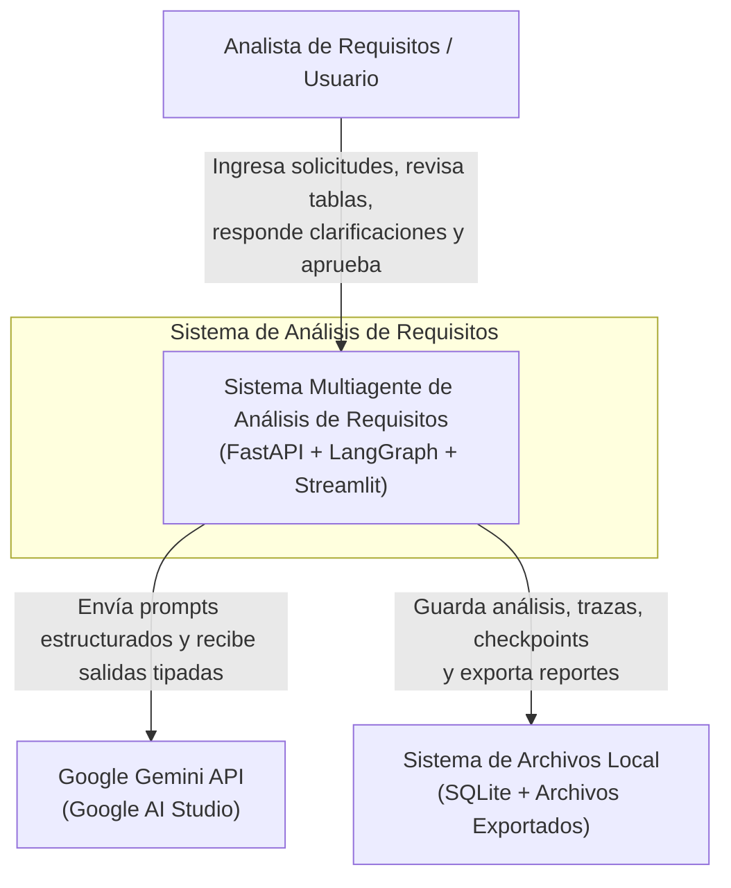
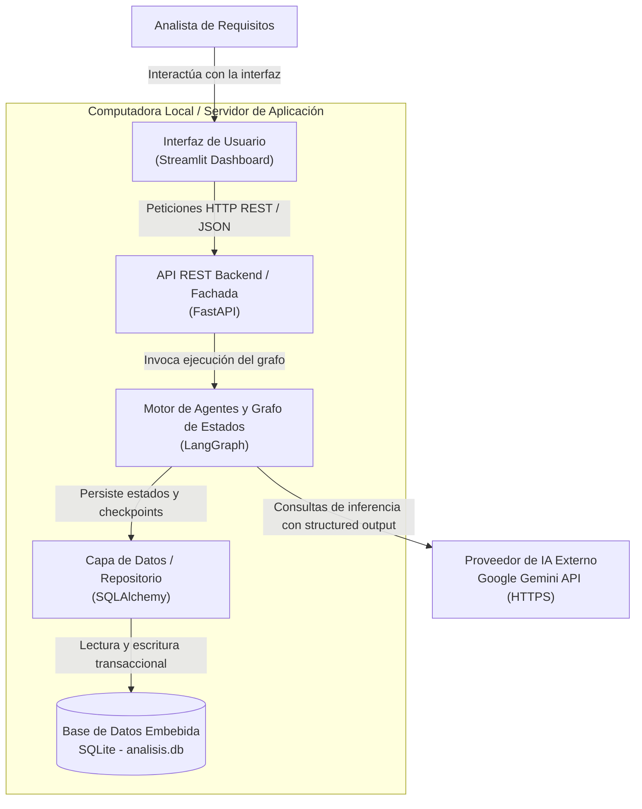
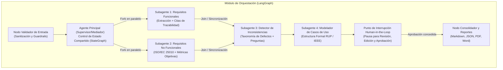
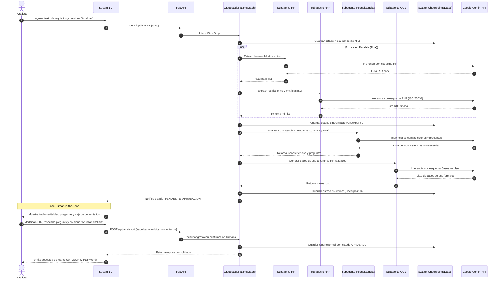
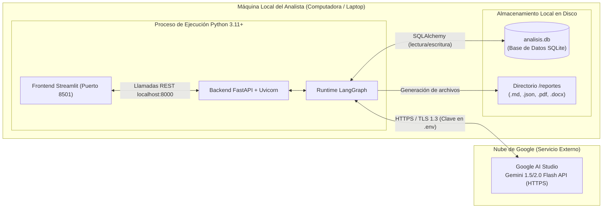
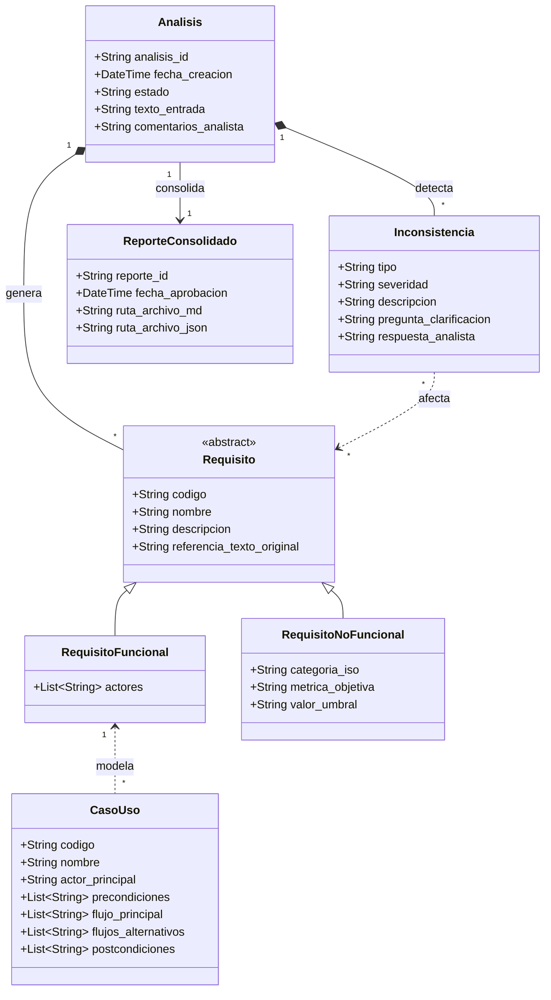

# Propuesta del Proyecto – Entrega 1 (Semana 13)
## Guion Estructurado para Presentación PPT y Defensa Técnica
**Curso:** Arquitectura y Evolución de Software (2026-2)

---

## 1. Carátula y Datos del Grupo
* **Tema Asignado:** Tema 3 – Agente de Análisis de Requisitos de Software.
* **Grupo:** Grupo 6
* **Integrantes:**
  * `202311375` - Castillo Jorge, Fabrizio Leonardo
  * `202211070` - Correa Giron, Joshue Sebastian
  * `202420891` - Mamani Leon, Sebastian Leonel
  * `200310095` - Martell Castillo, Francisco Jose

---

## 2. Problemática
* **Deficiencias en la entrada:** Los requisitos entregados por clientes o usuarios suelen ser informales, incompletos, redactados con ambigüedad o con contradicciones internas.
* **Confusión recurrente:** Mezcla habitual entre requerimientos funcionales (lo que hace el sistema) y restricciones de calidad (requisitos no funcionales).
* **Falta de rigor en casos de uso:** Omisión de precondiciones, pasos numerados de flujos principales y caminos alternativos ante excepciones.
* **Pérdida de trazabilidad:** Dificultad para auditar qué frase del texto original dio origen a cada requisito o caso de uso.
* **Costo de reproceso:** El análisis manual consume demasiado tiempo y los errores que pasan desapercibidos a las etapas de diseño y desarrollo incrementan sustancialmente los costos del proyecto.

---

## 3. Objetivos del Proyecto

### Objetivo General
Diseñar e implementar una solución de software basada en una arquitectura multiagente de inteligencia artificial para automatizar la extracción de requisitos funcionales y no funcionales, el modelado formal de casos de uso y la detección de inconsistencias semánticas a partir de descripciones textuales.

### Objetivos Específicos
1. Implementar un Agente Principal (Orquestador) que gobierne el ciclo de vida del análisis mediante un grafo de estados en **LangGraph**.
2. Desarrollar cuatro subagentes especializados con responsabilidades desacopladas: Requisitos Funcionales (IEEE 29148), Requisitos No Funcionales (ISO/IEC 25010), Modelador de Casos de Uso y Detector de Inconsistencias con preguntas de clarificación.
3. Establecer un flujo de orquestación híbrido que combine concurrencia en paralelo (*Fork/Join*) para extracción inicial y secuencia dependiente para validación y modelado.
4. Implementar persistencia desacoplada transaccional en **SQLite** para trazabilidad de requisitos, auditoría y recuperación por *checkpoints*.
5. Incorporar un mecanismo de validación humana (*Human-in-the-Loop*) que permita al analista revisar, editar, ingresar comentarios y aprobar formalmente las propuestas antes de emitir el reporte final.
6. Facilitar la exportación del reporte consolidado en Markdown y JSON como base obligatoria, y en PDF y Word mediante selección opcional.

---

## 4. Alcance y Limitaciones

### Alcance (Lo que el sistema hace):
* Ingesta de especificaciones textuales directas o archivos (.txt, .md, .pdf).
* Extracción atómica de Requisitos Funcionales vinculados a sus actores y citas de origen.
* Clasificación estructurada de Requisitos No Funcionales bajo las 8 dimensiones de la norma ISO/IEC 25010 con métricas objetivas.
* Generación de Casos de Uso formales (Precondiciones, Flujo Principal, Alternativos y Postcondiciones).
* Detección de inconsistencias por severidad (Alta, Media, Baja) y formulación de preguntas de clarificación.
* Pantalla de revisión interactiva donde el analista edita datos, responde dudas, deja comentarios y aprueba el reporte.
* Persistencia local de proyectos, análisis anteriores y puntos de control de ejecución.
* Exportación multiformato (Markdown, JSON, PDF y Word).

### Limitaciones Delimitadas:
* No genera código ejecutable ni scripts de bases de datos de la aplicación analizada.
* No sustituye el rol del analista de sistemas; opera como una herramienta inteligente de asistencia y aceleración.
* Diseñado como banco de trabajo local de analista; no incluye esquemas complejos de autenticación multiusuario ni cobros en la nube para evitar sobreingeniería.

---

## 5. Arquitectura Propuesta (Vistas y Diagramas)

### 5.1. Diagrama de Contexto (C4 - Nivel 1)
Delimita el sistema frente a los actores humanos y servicios externos:

---

### 5.2. Diagrama de Contenedores (C4 - Nivel 2)
Muestra las aplicaciones de software de alto nivel que componen la solución:

---

### 5.3. Diagrama de Componentes (C4 - Nivel 3)
Descompone el núcleo del Motor de Agentes y sus subagentes especializados:

---

### 5.4. Diagrama de Secuencia (Flujo Extremo a Extremo)
Ilustra la colaboración temporal de los agentes durante un análisis representativo:

---

### 5.5. Diagrama de Despliegue
Muestra cómo conviven los artefactos en la infraestructura física:

---

## 6. Decisiones Arquitectónicas y Justificación de Trade-offs

1. **Selección de LangGraph como Framework de Orquestación:**
   * *Decisión:* Emplear LangGraph para el control del pipeline de agentes.
   * *Justificación:* Modela el flujo como un grafo de estados determinista (`StateGraph`), soportando concurrencia nativa (*Fork/Join*), puntos de interrupción para aprobación humana (*Human-in-the-Loop*) y recuperación por *checkpoints* ante caídas.

2. **Persistencia Local con SQLite vs. Base de Datos en la Nube (AWS / Azure):**
   * *Decisión:* Uso de SQLite local mediante una capa desacoplada con SQLAlchemy.
   * *Justificación de Trade-off:* Desplegar una base de datos en la nube (ej. PostgreSQL en AWS RDS) para una herramienta de analista individual representaba **sobreingeniería**, generaba costos financieros innecesarios y agregaba una latencia de red de 150 a 300 ms en cada paso del grafo. SQLite ofrece ejecución instantánea (< 1 ms), alta portabilidad y reproducibilidad absoluta (el archivo se genera automáticamente en local y nunca se sube a Git). Sin embargo, la persistencia está desacoplada mediante el patrón Repositorio, permitiendo migrar a AWS en producción sin modificar el código de los agentes.

3. **Interfaz de Usuario en Streamlit vs. Trío Clásico (HTML + CSS + JavaScript):**
   * *Decisión:* Construcción del dashboard visual en Streamlit.
   * *Justificación de Trade-off:* Mantiene un **stack homogéneo 100% en Python**, permitiendo que todo el equipo trabaje sobre el mismo lenguaje. En un sistema de IA, el tiempo de procesamiento del LLM (10-20 segundos) hace que la diferencia de milisegundos de renderizado en el navegador sea insignificante, mientras que la velocidad de desarrollo y la facilidad de mantenimiento de Streamlit permiten concentrar los esfuerzos en la lógica multiagente.

4. **Proveedor de Inteligencia Artificial (Google Gemini API):**
   * *Decisión:* Uso del API de Google Gemini (Google AI Studio) como motor principal gratuito.
   * *Justificación:* Ofrece una ventana de contexto de más de un millón de tokens y alta velocidad de inferencia bajo una capa gratuita, dejando abierta la arquitectura para evaluar respaldos (como Groq o NVIDIA NIM) mediante una interfaz de adaptador desacoplada.

---

## 7. Tecnologías Seleccionadas
* **Lenguaje:** Python 3.11+
* **Orquestador:** LangGraph
* **Backend:** FastAPI
* **Frontend:** Streamlit
* **Modelos de IA:** Google Gemini API (AI Studio)
* **Validación de Datos:** Pydantic v2 (Esquemas estructurados estrictos)
* **Persistencia:** SQLite vía SQLAlchemy
* **Pruebas:** pytest
* **Control de versiones:** Git y GitHub

---

## 8. Requisitos Funcionales del Sistema (Resumen)
* **RF01:** Carga de texto directo o archivos (.txt, .md, .pdf).
* **RF02:** Validación y sanitización previa de entrada.
* **RF03:** Orquestación concurrente y dependiente de los subagentes.
* **RF04:** Extracción de RF atómicos con actores y citas del texto original.
* **RF05:** Clasificación de RNF en ISO/IEC 25010 con métricas objetivas.
* **RF06:** Modelado de Casos de Uso formales con flujos y pre/postcondiciones.
* **RF07:** Detección de inconsistencias categorizadas por severidad.
* **RF08:** Formulación de preguntas de clarificación estructuradas.
* **RF09:** Interfaz para revisión, edición, comentarios y aprobación del analista.
* **RF10:** Persistencia transaccional de estados y resultados en SQLite.
* **RF11:** Consulta de historial de análisis anteriores.
* **RF12:** Exportación de reportes en Markdown y JSON (con opción a PDF y Word).

---

## 9. Requisitos No Funcionales (ISO/IEC 25010)
* **RNF01 (Mantenibilidad):** Modularidad que permita añadir nuevos subagentes sin alterar los existentes.
* **RNF02 (Confiabilidad):** Validación previa del 100% de los datos mediante contratos Pydantic v2.
* **RNF03 (Seguridad):** Credenciales de API protegidas exclusivamente en variables de entorno (`.env`).
* **RNF04 (Rendimiento):** Tiempo total de respuesta $\le 60$ segundos para textos de hasta 1,000 palabras.
* **RNF05 (Fiabilidad / Resiliencia):** Tolerancia a fallos y reanudación desde checkpoints locales de SQLite.
* **RNF06 (Adecuación Funcional):** Trazabilidad explícita del 100% de los requisitos hacia sus citas textuales.
* **RNF07 (Portabilidad):** Capacidad de clonar y ejecutar el repositorio localmente sin servidores externos.

---

## 10. Casos de Uso del Sistema
* **CUS01:** Ingresar solicitud de análisis de requisitos.
* **CUS02:** Ejecutar pipeline de análisis multiagente en LangGraph.
* **CUS03:** Revisar propuestas, editar requisitos y responder preguntas de clarificación.
* **CUS04:** Aprobar formalmente el análisis de requisitos (*Human-in-the-Loop*).
* **CUS05:** Exportar informe final consolidado (MD, JSON, PDF, Word).
* **CUS06:** Consultar historial de análisis almacenados.

---

## 11. Reglas de Negocio
* **RN01:** No se inicia un análisis con entradas vacías o menores a 20 caracteres.
* **RN02:** Cada requisito funcional y caso de uso recibe un código único e inmutable (`RF01`, `CUS01`).
* **RN03:** Todo RF debe contener al menos un actor asociado y su frase textual de origen.
* **RN04:** Todo RNF debe pertenecer a una característica ISO 25010 y contar con una métrica cuantificable.
* **RN05:** Toda inconsistencia debe acompañarse de su nivel de severidad y una pregunta para el usuario.
* **RN06:** Los resultados generados son borradores hasta que medie la aprobación humana.
* **RN07:** Las respuestas de los agentes deben cumplir estrictamente sus contratos tipados sin excepción.

---

## 12. Contratos API y Esquemas de Comunicación
* **Contrato RF:** `codigo`, `nombre`, `descripcion`, `actores`, `referencia_texto_original`.
* **Contrato RNF:** `codigo`, `categoria_iso`, `descripcion`, `metrica_objetiva`, `valor_umbral`.
* **Contrato CUS:** `codigo`, `nombre`, `actor_principal`, `precondiciones`, `flujo_principal`, `flujos_alternativos`, `postcondiciones`.
* **Contrato Inconsistencia:** `tipo`, `severidad`, `elementos_afectados`, `descripcion_problema`, `pregunta_clarificacion`.
* **Endpoints REST:**
  * `POST /api/analisis` (Inicia análisis y retorna `analisis_id`).
  * `GET /api/analisis/{id}` (Consulta estado y resultados preliminares).
  * `POST /api/analisis/{id}/aprobar` (Envía correcciones, comentarios y sella la aprobación).
  * `GET /api/analisis` (Recupera historial de análisis).

---

## 13. Modelo de Dominio y Trazabilidad

---

## 14. Escenarios de Calidad (Séxtupla Formal del SEI)

| Atributo | Fuente del Estímulo | Estímulo | Artefacto Afectado | Entorno | Respuesta del Sistema | Medida de la Respuesta |
| :--- | :--- | :--- | :--- | :--- | :--- | :--- |
| **Modificabilidad** | Desarrollador | Desea incorporar un 5to subagente (ej. Estimación de Esfuerzo en Story Points). | Grafo LangGraph y Estado Compartido | Mantenimiento evolutivo | Se añade el nodo y sus aristas sin alterar el código de los otros subagentes. | Tiempo de integración $\le 2$ horas; 0 regresiones en pruebas unitarias. |
| **Rendimiento** | Analista | Envía una descripción de requisitos de 1,000 palabras para su análisis. | Pipeline Multiagente | Operación normal en computadora local | El orquestador ejecuta RF y RNF en paralelo, procesa dependencias y entrega borrador. | Latencia total extremo a extremo $\le 60$ segundos. |
| **Confiabilidad** | Proveedor de IA | La API externa de Google Gemini devuelve error temporal de cuota (HTTP 429). | Adaptador LLM y Orquestador | Picos de tráfico o saturación de cuota | Aplica política de reintento controlado y guarda checkpoint de forma segura. | 0 caídas del sistema (*crashes*); reanudación limpia desde último checkpoint. |
| **Seguridad** | Entrada externa | Envía texto con instrucciones maliciosas (*Prompt Injection / Jailbreak*). | Capa de Validación y Sanitización | Recepción de datos | La entrada se sanitiza y se aísla como datos pasivos de lectura sin ejecutar órdenes. | 100% de intentos de inyección neutralizados sin fuga de prompts del sistema. |
| **Observabilidad** | Administrador | Ocurre un fallo en uno de los subagentes durante el análisis. | Checkpoints y Trazas en SQLite | Ejecución en pruebas o producción | Registra identificador, nodo, error detallado, fecha y hora en la base de datos. | Tiempo de diagnóstico $< 5$ minutos; estado preservado para auditoría. |

---

## 15. Conceptos de Agentes y Subagentes
* **Agente Autónomo en Software:** Componente de software dotado de instrucciones especializadas, acceso a un modelo de lenguaje y herramientas para tomar decisiones acotadas sobre su tarea.
* **Arquitectura de Agentes vs. Chatbot Tradicional:** En un chatbot convencional, un solo modelo recibe un prompt general sin control estructurado. En una arquitectura de agentes, las tareas complejas se descomponen funcionalmente entre especialistas (Subagentes) con contratos estrictos de entrada y salida, bajo la supervisión de un mediador.
* **Separación de Responsabilidades (SRP):** Cada subagente del proyecto resuelve un problema concreto (funcionalidad, calidad, modelado, consistencia), permitiendo que cada componente sea testeable de forma independiente.

---

## 16. Conceptos de la Plataforma Seleccionada (LangGraph)
* **StateGraph (Grafo de Estados):** Estructura matemática donde los nodos representan funciones de agentes y las aristas definen las reglas de transición deterministas.
* **Estado Compartido Tipado (`AgentState`):** Objeto único centralizado donde cada agente lee la información necesaria y escribe exclusivamente sus hallazgos validados.
* **Bifurcación Concurrente (*Fork/Join*):** Capacidad nativa de ejecutar nodos independientes al mismo tiempo en hilos asíncronos y sincronizarlos antes de continuar.
* **Persistencia por Checkpoints:** Mecanismo que toma instantáneas del estado en base de datos tras cada paso, permitiendo pausar, retroceder y reanudar flujos de ejecución.
* **Human-in-the-Loop:** Capacidad del grafo de interrumpir su ejecución de forma controlada a la espera de una entrada o confirmación humana externa.

---

## 17. Técnicas Aplicadas
* **Grounding y Citación Textual:** Técnica que obliga al modelo a citar la frase exacta del documento original para cada requisito extraído, garantizando trazabilidad y eliminando alucinaciones.
* **Structured Outputs con Pydantic:** Uso de esquemas de datos estrictos en las llamadas al modelo de lenguaje para garantizar que las respuestas siempre sean objetos estructurados y nunca texto plano no tipado.
* **Orquestación Híbrida Paralela/Secuencial:** Combinación de paralelismo para tareas independientes (extracción de RF y RNF) y secuencialidad para tareas dependientes (modelado de casos de uso y cruce de inconsistencias).
* **Validación Humana con Edición y Comentarios:** Integración de la decisión del analista en el flujo de negocio antes de la consolidación final.
