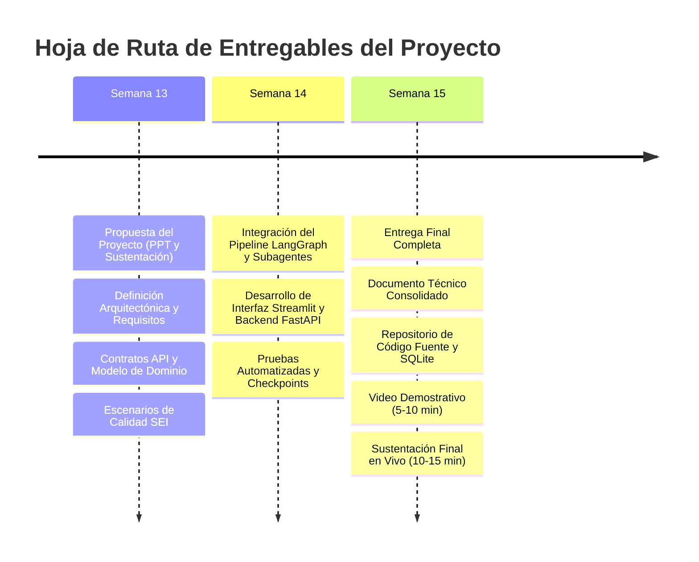

# Plan de Gestión del Equipo y Cronograma de Entregables
## Sistema Multiagente de Análisis de Requisitos de Software

**Curso:** Arquitectura y Evolución de Software (2026-2)  
**Grupo:** Grupo 6  
**Documento Complementario a:** `repo/docs/documento_maestro_propuesta.md`

---

## 1. Organización del Equipo y Distribución de Responsabilidades

El Grupo 6 está conformado por cuatro integrantes. Para garantizar el cumplimiento de los principios arquitectónicos de bajo acoplamiento y alta cohesión no solo en el código sino en el proceso de desarrollo, se distribuyen las responsabilidades por áreas de especialización:

| Integrante | Código | Responsabilidades Principales | Módulos y Artefactos a Cargo |
| :--- | :--- | :--- | :--- |
| **Castillo Jorge, Fabrizio Leonardo** | `202311375` | **Ingeniería de Requisitos y Calidad Funcional** | * Definición formal de problemática, objetivos y alcance del sistema. * Matriz de Requisitos Funcionales (IEEE 29148) y No Funcionales (ISO/IEC 25010). * Diseño del Subagente 1 (Extracción de RF) y Subagente 2 (Clasificación de RNF). |
| **Correa Giron, Joshue Sebastian** | `202211070` | **Arquitectura de Software y Orquestación Multiagente** | * Diseño del flujo de estados concurrente en LangGraph (*StateGraph*). * Implementación del Agente Principal / Orquestador (Mediador y Facade). * Flujo de interacción y validación humana (*Human-in-the-Loop*). * Patrones de diseño e integración de modelos de lenguaje (LLM Adapter). |
| **Mamani Leon, Sebastian Leonel** | `202420891` | **Modelo de Dominio, Casos de Uso y Servicios API** | * Especificación del Modelo de Dominio y esquemas de datos relacionales en SQLite. * Diseño del Subagente 3 (Inconsistencias) y Subagente 4 (Casos de Uso formales). * Catálogo de Reglas de Negocio del sistema. * Especificación y desarrollo de contratos REST en FastAPI y esquemas Pydantic. |
| **Martell Castillo, Francisco Jose** | `200310095` | **Infraestructura, Calidad de Arquitectura y Pruebas** | * Formalización de Escenarios de Calidad (Séxtupla del SEI). * Suite de automatización de pruebas unitarias y de integración en pytest. * Gestión de persistencia desacoplada (SQLAlchemy y checkpoints de LangGraph). * Mecanismos de seguridad (validación en frontera, variables `.env`) y métricas experimentales. |

---

## 2. Cronograma y Alcance de los Entregables del Curso

Para una adecuada planificación del semestre, se definen los hitos y entregables requeridos:

### 2.1. Entrega 1 – Semana 13: Propuesta del Proyecto
Presentación en diapositivas (PPT) y defensa inicial del proyecto conteniendo:
1. **Tema elegido:** Agente de Análisis de Requisitos de Software.
2. **Problemática:** Inconsistencias, ambigüedades y sobrecostos en el análisis manual de requerimientos.
3. **Objetivos:** Objetivo general y específicos orientados a arquitectura multiagente.
4. **Alcance y Limitaciones:** Capacidades de la herramienta y fronteras del prototipo.
5. **Arquitectura propuesta:** Diagrama de bloques, orquestación híbrida y separación en 4 capas.
6. **Tecnologías seleccionadas:** Justificación de Python, LangGraph, FastAPI, SQLite, Streamlit y Gemini API.
7. **Requisitos funcionales:** Matriz RF01 a RF15 bajo normas formales.
8. **Requisitos no funcionales:** Matriz RNF01 a RNF11 clasificados bajo ISO/IEC 25010.
9. **Casos de uso:** CUS01 a CUS07 modelando interacciones analista-sistema y flujo HITL.
10. **Reglas de negocio:** RN01 a RN12 cubriendo validación, inmutabilidad de datos y tipado.
11. **Contratos API:** Endpoints REST FastAPI y esquemas Pydantic de subagentes.
12. **Modelo de dominio:** Entidades conceptuales y trazabilidad integral.
13. **Escenarios de calidad:** 5 escenarios formalizados bajo la séxtupla del SEI.
14. **Conceptos de Agentes y Subagentes:** Roles de Orquestador, Analizador RF, Analizador RNF, Detector de Inconsistencias y Modelador de CdU.
15. **Conceptos de la plataforma seleccionada:** LangGraph (StateGraph, checkpoints, fork/join, interrupciones).
16. **Técnicas aplicadas:** Mediator, Ports & Adapters, Strategy, LLM Adapter, Facade, métricas cuantitativas.

### 2.2. Entrega Final – Semana 15: Sistema en Funcionamiento y Documentación Técnica
Presentación de la solución completa implementada:
1. **Documento Técnico de Arquitectura:** Informe exhaustivo (derivado de `documento_maestro_propuesta.md`) con las decisiones arquitectónicas consolidadas, patrones implementados, diagramas C4 y evidencias de verificación.
2. **Código Fuente y Repositorio:** Repositorio estructurado en GitHub con instrucciones reproducibles (`README.md`), dependencias (`requirements.txt` o `pyproject.toml`) y variables de entorno documentadas (`.env.example`).
3. **Base de Datos y Persistencia:** Esquema local SQLite poblado con análisis de prueba, trazabilidad de ejecuciones y checkpoints funcionales de LangGraph.
4. **Batería de Pruebas y Métricas:** Suite completa en `pytest` con mocks de API y cálculo experimental de las métricas de precisión, cobertura, detección de inconsistencias y estabilidad.
5. **Video Demostrativo:** Grabación audiovisual de 5 a 10 minutos demostrando el flujo completo: ingesta, ejecución concurrente, revisión interactiva HITL, resolución de clarificaciones, aprobación y exportación en múltiples formatos.
6. **Sustentación Final:** Exposición de 10 a 15 minutos ante el docente con demostración en vivo de la aplicación y explicación de las tácticas arquitectónicas aplicadas.
