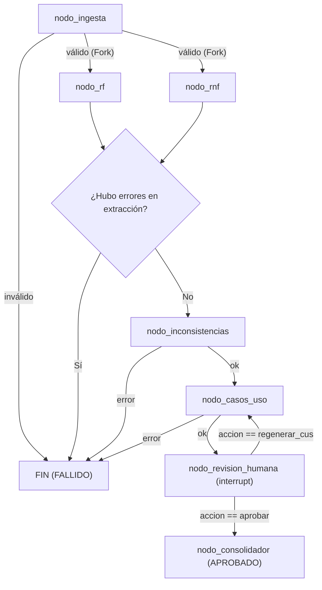

# Plan Técnico 001: Ingesta Dual, Orquestación Multiagente y Revisión Humana (HITL)

**Spec de origen:** [spec.md](./spec.md) (Aprobada)  
**Constitución:** [constitution.md](../constitution.md)

---

## 1. Arquitectura y Decisiones Técnicas

### 1.1. Estructura de Módulos Afectados
- `pyproject.toml`: declarar dependencias base (`pydantic>=2.0`, `langgraph`, `langgraph-checkpoint-sqlite`, `pypdf`) y de pruebas (`pytest`, `pytest-mock`), además de `pythonpath = ["."]`.
- `src/schemas/contracts.py` y `src/schemas/state.py`: contratos Pydantic v2 y `GraphState` tipado con reducers `operator.add`.
- `src/services/ingesta.py`: lector de fuentes (`.txt`, `.md`, `.pdf`, texto directo), validación de límites (`RN01`, `RN02`) y patrón **Strategy** (`EstrategiaDirecta` `< 1,000` palabras vs `EstrategiaSegmentacion` `1,000–10,000` palabras con solapamiento).
- `src/core/logger.py`: encapsular `logging.basicConfig` en `configurar_logging()` para evitar efectos secundarios en importación.
- `src/agents/`: soporte de `dict | BaseModel` (deserialización desde checkpoints), manejo seguro de `None`, política de hasta 2 reintentos ante errores transitorios (`RN11`), consolidación por lotes en `RF`/`RNF` y selección `rf_aprobados or requisitos_funcionales` en `nodo_casos_uso`.
- `src/graph/workflow.py`: `StateGraph(GraphState)` con checkpointer (`SqliteSaver` o `InMemorySaver` en tests), bifurcación paralela `RF || RNF`, compuerta de fallo (`FALLIDO`), `Inconsistencias`, `Casos de Uso`, pausa `interrupt()` para HITL y bucle condicional `regenerar_cus` vs `aprobar` → `ReporteConsolidado`.

---

## 2. Diseño Detallado de Contratos y Flujo

### 2.1. Contratos (`src/schemas/contracts.py` y `state.py`)
- **`contracts.py`:**
  - `TextoNoVacio = Annotated[str, Field(min_length=1)]` para listas de `RequisitoFuncional.actores` y `CasoUso` (`precondiciones`, `flujos_alternativos`, `postcondiciones`).
  - `Inconsistencia`: agregar `respuesta_analista: str | None = Field(default=None, ...)`.
  - `TrazaEjecucion`: `nodo`, `estado` (`COMPLETADO` | `REINTENTO` | `FALLIDO`), `inicio_iso`, `fin_iso`, `detalle`.
  - `DecisionRevision`: `accion: Literal["aprobar", "regenerar_cus"]`, `rf_editados`, `rnf_editados`, `casos_uso_editados`, `respuestas_clarificacion: dict[str, str]`, `comentarios_analista: str`.
  - `ReporteConsolidado`: inmutable (`frozen=True`), solo construible cuando `estado == "APROBADO"` (validación explícita en constructor/función consolidar).
- **`state.py` (`GraphState`):**
  - `analisis_id: str`
  - `estado: Literal["EN_PROCESO", "PENDIENTE_APROBACION", "APROBADO", "FALLIDO"]`
  - `texto_usuario: str`, `ruta_archivo: str | None`, `tamano_bytes: int`
  - `estrategia_ingesta: Literal["directa", "lotes"]`, `fragmentos: list[str]`
  - `requisitos_funcionales`, `requisitos_no_funcionales`, `inconsistencias`, `casos_uso`, `rf_aprobados`
  - `respuestas_clarificacion: dict[str, str]`, `comentarios_analista: str`, `reporte_consolidado: ReporteConsolidado | None`
  - `errores: Annotated[list[str], operator.add]`
  - `trazas: Annotated[list[TrazaEjecucion], operator.add]`

### 2.2. Estrategia de Ingesta Dual (`src/services/ingesta.py`)
- **Validación previa (`validar_y_preparar_entrada`):**
  1. Verificar extensión permitida (`.txt`, `.md`, `.pdf`) si se provee archivo y tamaño `<= 10 * 1024 * 1024` bytes (`10 MB`).
  2. Extraer texto (UTF-8 para `.txt`/`.md`, `pypdf.PdfReader` para `.pdf`).
  3. Normalizar espacios y verificar `>= 20` caracteres significativos (`RN01`) y `<= 10,000` palabras (`RN02`).
- **Patrón Strategy:**
  - `< 1,000` palabras → `EstrategiaDirecta`: devuelve `[texto]` (`estrategia_ingesta="directa"`).
  - `1,000–10,000` palabras → `EstrategiaSegmentacion`: ventana deslizante por palabras (`tamano_lote=800`, `solapamiento=100`) devolviendo `fragmentos` (`estrategia_ingesta="lotes"`).
  - Consolidación de lotes en `RF` y `RNF`: deduplicación por normalización de descripción/nombre y renumeración correlativa `RF-01..` / `RNF-01..`.

### 2.3. Topología del `StateGraph` (`src/graph/workflow.py`)

---

## 3. Plan de Commits Progresivos ($\le 300$ líneas por commit, 1 dominio)

1. **`chore(deps): declarar dependencias base y configuracion de pytest`** (`pyproject.toml`, ~25 líneas).
2. **`fix(schemas): actualizar contratos y reducers para spec 001`** (`src/schemas/state.py`, `src/schemas/contracts.py`, `tests/unit/test_schemas_spec001.py`, ~140 líneas).
3. **`feat(ingesta): implementar validacion de limites y estrategia dual por lotes`** (`src/services/ingesta.py`, `tests/unit/test_ingesta_spec001.py`, ~180 líneas).
4. **`fix(agents): soportar lotes, reintentos, checkpoints y flujo preliminar cus`** (`src/core/logger.py`, `src/agents/*.py`, `tests/unit/test_agentes.py`, ~170 líneas).
5. **`feat(graph): implementar StateGraph con fork-join, checkpoints y HITL`** (`src/graph/__init__.py`, `src/graph/workflow.py`, `tests/unit/test_graph_spec001.py`, ~220 líneas).

---

## 4. Estrategia de Verificación
- **TDD estricto:** Antes de cada implementación se escriben los tests derivados de los Escenarios de Aceptación de `spec.md`, nombrados con el prefijo `test_req_01_*` .. `test_req_08_*`.
- **Ejecución:** `C:\Users\joshu\AppData\Local\Programs\Python\Python312\python.exe -m pytest -v` después de cada fase, verificando 100% de tests en verde con mocks (cero llamadas de red).
