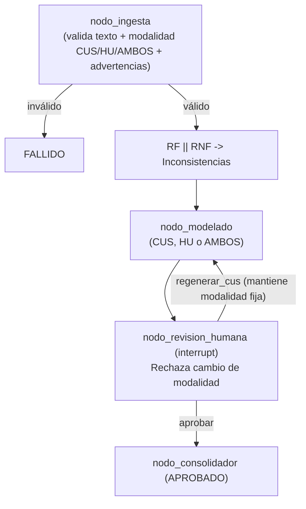

# Plan Técnico 002: Selección Previa y Modelado en CUS, HU o Ambos

**Spec de origen:** [spec.md](./spec.md) (Aprobada)  
**Constitución:** [constitution.md](../constitution.md)

---

## 1. Arquitectura y Decisiones Técnicas

### 1.1. Contratos y Estado (`src/schemas/`)
- **`src/schemas/contracts.py`:**
  - `ModalidadModelado = Literal["CUS", "HU", "AMBOS"]`
  - `CriterioAceptacion(ContratoBase)`: `dado: TextoNoVacio`, `cuando: TextoNoVacio`, `entonces: TextoNoVacio` (garantiza formato `DADO / CUANDO / ENTONCES`).
  - `HistoriaUsuario(ContratoBase)`: `id` (`^HU-\d{2,}$`), `titulo` (`min_length=3`), `como` (`min_length=2`), `quiero` (`min_length=5`), `para_que` (`min_length=5`), `criterios_aceptacion: list[CriterioAceptacion]` (`min_length=1`), `rf_relacionados: list[str]`. *(Sin campo `prioridad`, según Spec 002).*
  - `SalidaHU(ContratoBase)`: `historias_usuario: list[HistoriaUsuario]`.
  - `DecisionRevision`: agregar `modalidad_solicitada: ModalidadModelado | None = None` y `hu_editadas: list[HistoriaUsuario] | None = None`.
  - `ReporteConsolidado` y `consolidar_reporte(...)`: agregar `modalidad_modelado: ModalidadModelado = "CUS"` y `historias_usuario: list[HistoriaUsuario] = Field(default_factory=list)`.
  - `validar_decision_revision(modalidad_fija: ModalidadModelado, decision: DecisionRevision) -> None`: rechaza con `ValueError` si `decision.modalidad_solicitada` difiere de `modalidad_fija`.
- **`src/schemas/state.py` (`GraphState`):**
  - Agregar `modalidad_modelado: ModalidadModelado`, `historias_usuario: list[HistoriaUsuario]` y `advertencias: list[str]`.

### 1.2. Validación de Modalidad y Advertencias (`src/services/ingesta.py`)
- Función `validar_modalidad_modelado(modalidad: str | None) -> tuple[ModalidadModelado, list[str]]`:
  - Rechaza `None` o valores fuera de `{"CUS", "HU", "AMBOS"}` con `ValueError`.
  - Emite siempre la advertencia de formato fijo por corrida.
  - Si `modalidad == "AMBOS"`, añade la notificación de mayor tiempo de procesamiento.

### 1.3. Modelador Configurable (`src/agents/use_case_agent.py`)
- Mantener `nodo_casos_uso(state, cliente)` y agregar:
  - `nodo_historias_usuario(state, cliente)`: exige al menos un RF (`rf_aprobados or requisitos_funcionales`) y solicita `SalidaHU` con narrativa `COMO/QUIERO/PARA QUE` y criterios `DADO/CUANDO/ENTONCES`.
  - `nodo_modelado(state, cliente)`: despacha según `state["modalidad_modelado"]`:
    - `"CUS"` → genera `casos_uso`, deja `historias_usuario = []`.
    - `"HU"` → genera `historias_usuario`, deja `casos_uso = []`.
    - `"AMBOS"` → genera ambos secuencialmente consolidando `trazas` y deteniéndose si alguno falla.

### 1.4. Integración en Grafo LangGraph (`src/graph/workflow.py`)

- En `nodo_ingesta`: exigir `modalidad_modelado` válida (sin valor implícito silencioso) y almacenar `advertencias`.
- En `nodo_revision_humana`: validar inmutabilidad con `validar_decision_revision`, aplicar `hu_editadas` y `cus_editados`, y en `regenerar_cus` volver a `nodo_modelado` manteniendo intacta `modalidad_modelado`.
- Actualizar los casos base de `tests/unit/test_graph_spec001.py` para enviar `"modalidad_modelado": "CUS"` de forma explícita conforme a `REQ-01` de Spec 002.

---

## 2. Plan de Commits Progresivos ($\le 300$ líneas por commit, 1 dominio)
1. **`fix(schemas): agregar contratos hu y validacion de modalidad fija`** (`contracts.py`, `state.py`, `tests/unit/test_schemas_spec002.py`, ~145 líneas).
2. **`feat(ingesta): validar modalidad previa y advertencias de corrida`** (`src/services/ingesta.py`, `tests/unit/test_ingesta_spec002.py`, ~75 líneas).
3. **`feat(agents): soportar modelado cus, hu o ambos en subagente 4`** (`src/agents/use_case_agent.py`, `tests/unit/test_agentes_spec002.py`, ~130 líneas).
4. **`feat(graph): enrutar modelado cus, hu o ambos con modalidad fija en hitl`** (`src/graph/workflow.py`, ajuste en `test_graph_spec001.py`, `tests/unit/test_graph_spec002.py`, ~210 líneas).

---

## 3. Verificación
- Ejecutar `C:\Users\joshu\AppData\Local\Programs\Python\Python312\python.exe -m pytest -v` tras cada fase (todos los tests de Spec 001 + Spec 002 en verde con mocks).
